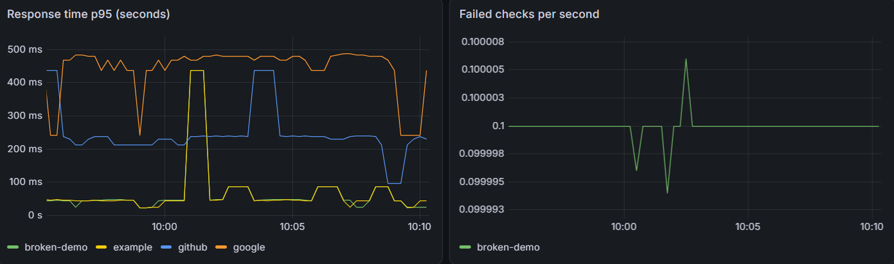

# Service Health Monitor


A small Go service that checks a list of HTTP endpoints concurrently (one goroutine per target)
and exposes the results as Prometheus metrics. The stack ships with Prometheus and Grafana,
runs with Docker Compose, and is tested, linted and published as a Docker image by GitHub Actions.

## Architecture

```
targets.json --> health-monitor (Go, :8080) <-- scrape every 10s -- Prometheus (:9090) <-- Grafana (:3000)
                  /health  /metrics
```

## Run it

Requirements: Docker with Docker Compose.

```bash
./scripts/deploy.sh
```

| What       | URL                           |
|------------|-------------------------------|
| Metrics    | http://localhost:8080/metrics |
| Prometheus | http://localhost:9090/targets |
| Grafana    | http://localhost:3000 (admin / admin) |

Stop everything with `docker compose down`.

## Configuration

Targets are defined in `targets.json`. Environment variables:

| Variable      | Default        | Meaning                    |
|---------------|----------------|----------------------------|
| `CONFIG_PATH` | `targets.json` | Path to the targets file   |
| `LISTEN_ADDR` | `:8080`        | Address of the HTTP server |

## Metrics

| Metric                           | Type      | Labels          |
|----------------------------------|-----------|-----------------|
| `healthmonitor_target_up`        | gauge     | target, url     |
| `healthmonitor_response_seconds` | histogram | target          |
| `healthmonitor_checks_total`     | counter   | target, result  |

Example Grafana queries:

```
healthmonitor_target_up
histogram_quantile(0.95, sum(rate(healthmonitor_response_seconds_bucket[1m])) by (le, target))
sum(rate(healthmonitor_checks_total{result="failure"}[1m])) by (target)
```

## Development

```bash
go test -race -cover ./...
go run .
```

## CI/CD

On every push to `main`: `go vet` and tests, `golangci-lint`, then a Docker image is built
and pushed to `ghcr.io/vukasin-nik/health-monitor`.

## Screenshots


